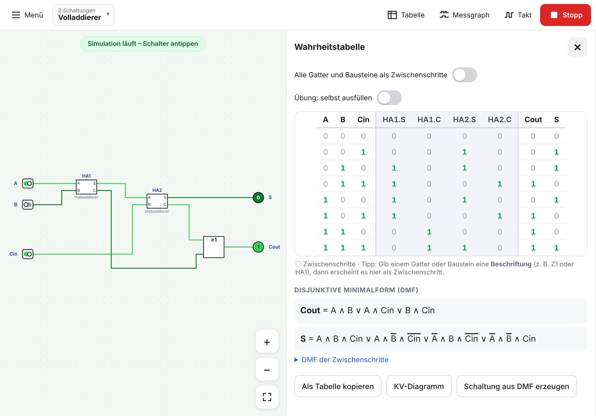

# Digital Web

Ein Simulator für digitale Schaltungen im Browser, optimiert für das iPad im Unterricht.
Er ist angelehnt an [Digital](https://github.com/hneemann/Digital) von Helmut Neemann und
liest und schreibt dessen `.dig`-Dateien.



## Funktionen

- **Touch-Bedienung:** Bauteile antippen oder auf die Fläche ziehen. Leitungen zieht man vom Anschlusspunkt aus. Verschoben wird mit einem Finger, gezoomt mit zwei. Der Apple Pencil funktioniert ebenfalls. Die Bauteilleiste hat eine Suche und „Zuletzt benutzt“; selten gebrauchte Kategorien sind eingeklappt.
- **Dunkler Modus:** Menü → Darstellung: „Wie iPad“ (folgt der Systemeinstellung), „Hell“ oder „Dunkel“. Exportierte Bilder sind immer hell (für Arbeitsblätter).
- **Schaltzeichen nach DIN EN 60617** (&, ≥1, =1, 1 mit Negationskreis). Die amerikanischen IEEE-Symbole lassen sich optional einschalten.
- **Bauteile (rund 100, wie in Digital):**
  - Ein-/Ausgabe: Ein-/Ausgänge (auch mehrbittig), LED, RGB-LED, LED mit Polung (Anode/Kathode), Glühlampe, Taster, Taster mit LED, DIP-Schalter, Drehgeber, Takt, Konstante, Masse/Versorgung, Messwert, 7-Segment-Anzeigen
  - Logik und Plexer: UND/ODER/NICHT/NAND/NOR/XOR/XNOR (2–16 Eingänge, negierbar), Multiplexer, Demultiplexer, Decoder, Prioritätsencoder, Bit-Auswahl
  - Flipflops: RS, JK, D, T (auch mit Set/Clr), Monoflop
  - Arithmetik: Addierer, Subtrahierer, Multiplizierer, Dividierer, Negation, Komparator, Barrel-Shifter, Bitzähler, Vorzeichenerweiterung, Zähler, Zähler mit Voreinstellung, Register, Zufallszahlen
  - Speicher: ROM, RAM (verschiedene Varianten, auch asynchron und mit CS/WE/OE), EEPROM, Block-RAM, Registersatz, Lookup-Tabelle – mit Inhaltseditor (Hex/Dezimal/Binär, Import von Intel-HEX, Binär- und Textdateien) und Live-Ansicht während der Simulation
  - Schalter & Transistoren: Schalter, Umschalter, Relais, N-/P-FET (bidirektional), Floating-Gate-FETs, Transmission-Gate, Sicherung, Dioden
  - Anzeigen & Terminal: LED-Matrix, Terminal, Tastatur, Grafikkarte, VGA-Monitor
  - Leitungen & Simulation: Tunnel, Splitter, Bus-Splitter, Treiber, Pull-up/-down, Verzögerung, Pin-Steuerung, nicht verbunden, Stopp, Reset, Haltepunkt, Rahmen, Text
- **Simulation** mit Farbcodierung der Leitungen (hellgrün = 1, dunkelgrün = 0, blau = offen, rot = Fehler). Sie erkennt Kurzschlüsse, falsche Bitbreiten und schwingende Schaltungen.
- **Wahrheitstabelle** per Knopfdruck mit **Zwischenschritten**: Beschriftete Gatter (z. B. „Z1“) erscheinen als eigene Spalten, wahlweise auch alle Gatter. Dazu kommen die **disjunktive Minimalform (DMF)** mit Negation als Überstrich und **KV-Diagramme** mit farbig markierten Primimplikanten.
- **Wahrheitstabelle eingeben** (auch mit X = don't care) → DMF, KV-Diagramm und Schaltung. **Übungsmodus:** Ausgänge einer Schaltung selbst ausfüllen und prüfen lassen. Die Tabelle ist neben der Schaltung angedockt, sodass beides sichtbar bleibt.
- **Schaltwerke:** Zustandsanalyse von Schaltungen mit D-, JK-, T- und RS-Flipflops (Zustandsübergangstabelle, Ansteuerung, Zustandsdiagramm, Gleichungen) sowie ein **Automaten-Editor** für Moore- und Mealy-Automaten, der aus dem Zustandsdiagramm eine Schaltung mit D-, JK- oder T-Flipflops erzeugt (mit Ansteuertabelle).
- **74xx-Bibliothek:** 118 Chips aus der Bibliothek von Digital (z. B. 7400, 7447, 74595, 74161), als DIL-Gehäuse mit Pin-Nummern. Sie werden beim Öffnen von .dig-Dateien automatisch nachgeladen. Alle 51 Chips mit Original-Testfällen von Digital bestehen diese (auch 7489, 74189 und der FIFO 7440105), der 74595 einen eigenen Funktionstest.
- **Schaltungssynthese:** Schaltung aus der DMF oder aus einer eingegebenen Formel erzeugen (z. B. `Y = ¬(A ∧ B) ∨ C`).
- **Eigene Bausteine (Teilschaltungen):** Ein Projekt kann mehrere Schaltungen enthalten, und jede lässt sich in den anderen als Baustein einsetzen. Die Anschlüsse sind die beschrifteten Ein- und Ausgänge, wie in Digital.
- **Bausteine bauen:** Teile einer Schaltung auswählen → „Als Baustein zusammenfassen“. Die Auswahl wird zu einer eigenen Schaltung mit Ein- und Ausgängen, an ihrer Stelle steht der neue Baustein und ist schon angeschlossen. Unter Menü → Projekt → „Aussehen als Baustein“ lassen sich Form (Rechteck, DIL-Gehäuse wie ein IC, Anschlüsse wie in der Schaltung, verkleinerte Schaltung), Breite, Pin-Nummern und eine Beschreibung einstellen.
- **Generische Schaltungen** wie in Digital: Parameter (z. B. Bitbreite) beim Einsetzen festlegen, Bauteile passen sich über Code an (`this.Bits = args.bits;`); Code-Bauteile können Bauteile und Leitungen erzeugen. Die Skriptsprache von Digital wird interpretiert.
- **Messgraph:** Zeitdiagramm aller Ein- und Ausgänge während der Simulation. Die Taktfrequenz ist auch während der Simulation einstellbar.
- **Testfälle** im Format von Digital (Bauteil „Testfall“), inklusive `loop`, `while`, `repeat`, `let`, `declare`, `init`, `memory`, `program`, `bits(…)` und `resetRandom`. Ergebnis mit Markierung falscher Zeilen.
- **Dateien:** Automatische Sicherung im Browser. Export als `.dig` (bei Bausteinen mehrere Dateien bzw. ZIP), PNG, **Verilog** oder **VHDL**. Import von `.dig`- und `.zip`-Dateien, auch mehrere gleichzeitig.
- **Offline-fähig (PWA):** In Safari über *Teilen → Zum Home-Bildschirm* wie eine App installierbar

## Veröffentlichen mit GitHub Pages

1. Neues Repository auf GitHub anlegen, z. B. `digital-web`.
2. Den Inhalt dieses Ordners hochladen. Im Browser geht das über *Add file → Upload files*, alternativ per Git:
   ```bash
   git remote add origin https://github.com/BENUTZERNAME/digital-web.git
   git push -u origin main
   ```
3. Im Repository unter **Settings → Pages** bei *Source* „Deploy from a branch“ wählen, dann Branch `main` und Ordner `/ (root)` → **Save**.
4. Nach ca. einer Minute ist die App unter `https://BENUTZERNAME.github.io/digital-web/` erreichbar.

Es gibt keinen Build-Schritt: reines HTML, CSS und JavaScript (ES-Module).

## Lokal testen

```bash
python3 -m http.server 8000
# dann http://localhost:8000 öffnen
```

(Ein Webserver ist nötig, weil Browser ES-Module nicht direkt von `file://` laden.)

## Projektstruktur

| Datei | Inhalt |
|---|---|
| `js/components.js` | Bauteil-Bibliothek: Geometrie, Symbole, Logik |
| `js/circuit.js` | Datenmodell, Netzbildung, Aufräumen von Leitungen |
| `js/sim.js` | Ereignisgesteuerter Simulator |
| `js/editor.js` | Zeichenfläche und Touch-Bedienung |
| `js/dig.js` | Import und Export des `.dig`-Formats |
| `js/analysis.js` | Wahrheitstabelle, Zwischenschritte, Minimierung (Quine-McCluskey) |
| `js/kv.js` | KV-Diagramme |
| `js/synth.js` | Formel-Parser, Darstellung, Schaltungsaufbau |
| `js/graph.js` | Messgraph |
| `js/testcase.js` | Testfälle |
| `js/lib.js` | Projekt-Bibliothek für Bausteine |
| `js/module.js` | Auswahl → Baustein, einfache Leitungsführung |
| `js/base.js` | Gemeinsame Hilfen für Bauteile (Form, Eigenschaften) |
| `js/comp-switch.js`, `comp-arith.js`, `comp-mem.js`, `comp-io.js` | Bauteilgruppen: Schalterebene, Arithmetik, Speicher, Ein-/Ausgabe |
| `js/hgs.js`, `js/generics.js` | Skriptsprache von Digital und generische Schaltungen |
| `js/hdl.js` | Export als Verilog und VHDL |
| `js/zip.js` | ZIP lesen/schreiben |
| `js/seq.js` | Schaltwerke: Zustandsanalyse, Zustandsdiagramm, Automaten-Synthese |
| `js/fsmeditor.js` | Automaten-Editor |
| `lib/74xx/` | 74xx-Chips aus Digital, `lib/index.json` = Verzeichnis |
| `js/app.js` | Oberfläche, Dialoge, Speichern |
| `js/examples.js` | Beispielschaltungen |

## Kompatibilität mit Digital

Positionen, Raster (20), Anschlusspunkte und Drehung entsprechen dem Desktop-Programm.
Nicht unterstützte Bauteile aus `.dig`-Dateien werden als Platzhalter angezeigt und beim
Speichern unverändert zurückgeschrieben.

## Grenzen gegenüber Digital

- Zahlen werden als JavaScript-Zahlen gerechnet: über 53 Bit (bis 64 Bit) sind Werte ungenau; Gatter rechnen bitweise bis 32 Bit.
- Nicht nachgebaut: externe Programme (External, ghdl/Icarus-Anbindung), MIDI, Schrittmotoren, eigene gezeichnete Bausteinformen (CUSTOM) und Telnet.
- VGA-Monitor: Bildgröße wird aus den Synchronimpulsen ermittelt (ohne Liste der Videomodi). Echte VGA-Takte sind im Browser zu schnell; für kleine Auflösungen geeignet.
- Verilog/VHDL-Export: eine flache Beschreibung (Bausteine aufgelöst), ohne Testbench. VHDL unterstützt weniger Bauteile als Verilog. Schalter, Transistoren und Geräte wie Terminal haben keine HDL-Entsprechung.
- Monoflop: zählt die steigenden Flanken aller Takt-Eingänge der Schaltung (Digital verlangt genau einen Takt).

## Lizenz

GPL-3.0, wie das Original-Projekt *Digital*, aus dem Geometrie und Dateiformat übernommen sind. Die Dateien in `lib/74xx` stammen unverändert aus [Digital](https://github.com/hneemann/Digital) von Helmut Neemann (GPL-3.0, siehe `lib/LICENSE-Digital.txt`).
